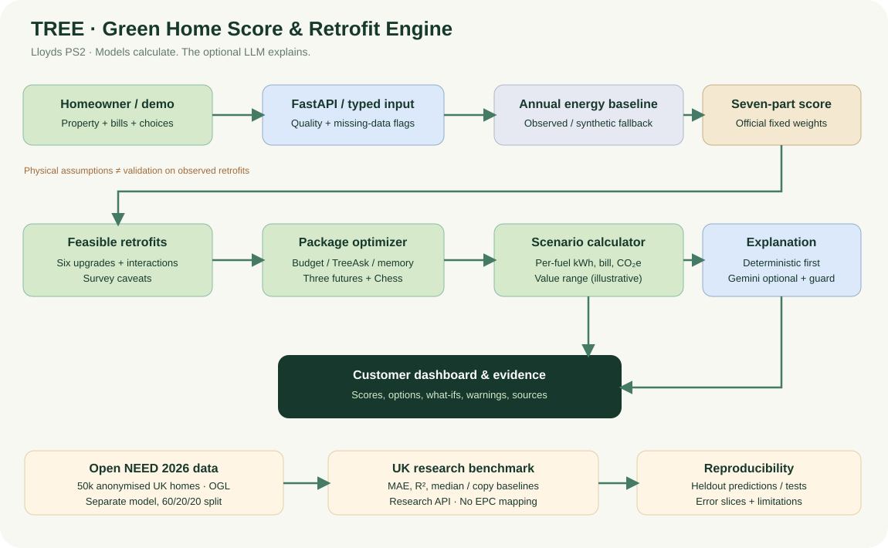

<div align="center">

# 🌳 TREE
### Making greener homes a little less complicated.

**AI-Powered Home Energy Analysis & Retrofit Recommendation System**

Built for **MegathonX 2026 | IIIT Hyderabad**  
**Lloyds Banking Group — Problem Statement 2**

</div>

---

## 🌍 The Idea

Making a home more energy-efficient sounds simple, until you actually try to figure out where to start.

Should you install solar panels? Improve insulation? Switch to a heat pump? And how much would any of it actually save?

That's the problem we wanted to solve.

**TREE** helps UK homeowners understand their home's energy performance, explore possible improvements, and identify upgrades that make sense for their budget.

Instead of recommending individual upgrades in isolation, TREE considers how different improvements work together.

## ✨ What TREE Can Do

- 🏡 **Home Energy Analysis** — Assess a property's current energy performance.
- 🌱 **Green Home Score** — Generate an explainable sustainability score.
- 🧠 **Intelligent Recommendations** — Explore suitable energy-efficiency upgrades.
- 💰 **Budget-Aware Optimization** — Compare combinations of improvements within a budget.
- ⚡ **Energy Predictions** — Estimate potential changes in household energy consumption.
- 📉 **Savings Analysis** — Compare projected energy bills and carbon emissions.
- 🔄 **What-If Simulations** — Explore how different retrofit decisions affect outcomes.

## 🏗️ System Architecture



TREE combines property information, energy calculations, machine-learning components, and retrofit simulation to generate recommendations.

**Workflow:**

1. Collect property details and available energy information.
2. Estimate baseline energy performance.
3. Calculate the Green Home Score.
4. Evaluate potential improvements.
5. Compare upgrade packages under budget constraints.
6. Present estimated savings and explanations.

## 🛠️ Tech Stack

| Component | Technology |
|-----------|------------|
| Frontend | HTML, CSS, JavaScript |
| Backend | Python, FastAPI |
| Machine Learning | Scikit-learn |
| Data Processing | Pandas, NumPy |
| Database | SQLite |
| API | REST |
| Testing | Pytest |

## 🎬 Project Demo

**Demo Video:** Coming soon!

**Live Website:** [Launch TREE](https://tree-n3yk.onrender.com/app#locate)

## 🚀 Running TREE Locally

### 1. Clone the repository

```bash
git clone https://github.com/desharajudevihasini/TREE.git
cd TREE
```

### 2. Set up Python

Python 3.11 is recommended.

```bash
python3.11 -m venv .venv311
source .venv311/bin/activate
```

### 3. Install dependencies

```bash
pip install -r requirements.txt
```

### 4. Start the application

```bash
python -m uvicorn backend.main:app --reload --port 8000
```

### 5. Open TREE

Visit:

http://127.0.0.1:8000

## 📊 Project Limitations

TREE is a hackathon prototype intended for exploring household energy-efficiency decisions.

Predicted savings, retrofit costs, and carbon reductions are estimates based on available inputs and modelling assumptions. They should not be treated as guaranteed real-world outcomes or professional energy assessments.

## 🏆 Hackathon Journey

**MegathonX 2026 — IIIT Hyderabad**

Developed in response to Lloyds Banking Group's sustainability challenge.

Our team advanced to **Round 2**, where we had the opportunity to develop and present our approach to making greener home improvements more accessible and understandable.

## 🔮 What's Next?

- Improve energy prediction accuracy with additional validated datasets.
- Expand retrofit recommendations.
- Improve explanations and uncertainty reporting.
- Explore more comprehensive property-energy assessments.

---

<div align="center">

### 🌳 TREE

*Because making your home greener shouldn't require you to be an energy expert.*


</div>
