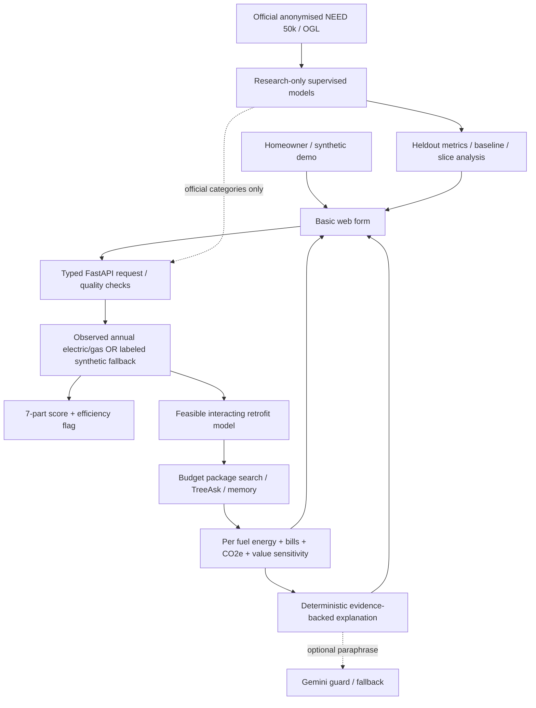

# TREE systems / safety boundaries

The inspectable SVG architecture diagram is **`docs/architecture.svg`**. The basic homeowner interface is FastAPI-served static HTML/JS at `/`; the original artistic design is preserved at `/studio` for the final UX pass.



**System boundaries:** Python always owns numeric outputs. Chat may parse a request to choose a scenario but cannot manufacture a score. Missing information yields warnings, unavailable ranking/value where necessary or a clearly labeled fallback estimate. Retrofits must be physically eligible under stated demo checks, with surveys required before real construction. Local memory is pseudonymous, optional and stored in a demo SQLite database; it is not a production customer system.

**Research-model boundary:** `ml/serve_need.py` consumes 11 categorical fields in the official 2026 NEED schema. Neither browser geolocation nor arbitrary user property descriptions are automatically translated into those fields. Measured heldout NEED performance must never be presented as validated individual-home estimates or retrofit energy outcomes.

**Inferences and assumptions:** See `docs/assumptions.md`, `docs/scoring_method.md`, `docs/data_dictionary.md`, `docs/llm_evaluation.md`, `docs/responsible_ai.md` and `PPT_EVERY_SLIDE_AUDIT.md`.

## Location-first extension (October 2026)

```text
UK postcode → configured EPC provider → address confirmation → signed EPC result
                                    ↘ missing/ambiguous fields remain null
   Manual home entry ────────────────→ TreeAsk / homeowner evidence wizard
   Text energy bill PDF/TXT ────────→ candidate kWh only → homeowner confirms
   Image/video local inspection ────→ no automatic facts
   Optional consented Gemini image → unverified textual observations only
                                           ↓
                              canonical Property object
                                           ↓
                 bills (observed) OR NEED consumer ML (coarse)
                                           ↓
            score → feasibility → interacting energy model
                      ↓                      ↓
                budget optimizer      per-fuel carbon & £
                      └──────→ indicative value range
                                       ↓
                     deterministic approved answer
                                       ↓
                     optional guarded Gemini paraphrase
                                       ↓
                 home dashboard / scenarios / memory

            Separate: appliance & water/waste sustainability audit
                      (no unsupported score credit)
```

No API key is shipped. EPC searches are intentionally disabled when no provider is configured; the site supports manual/demo paths. The optional image pathway is separate from the official scoring data to prevent hallucinated fields from entering calculations.
